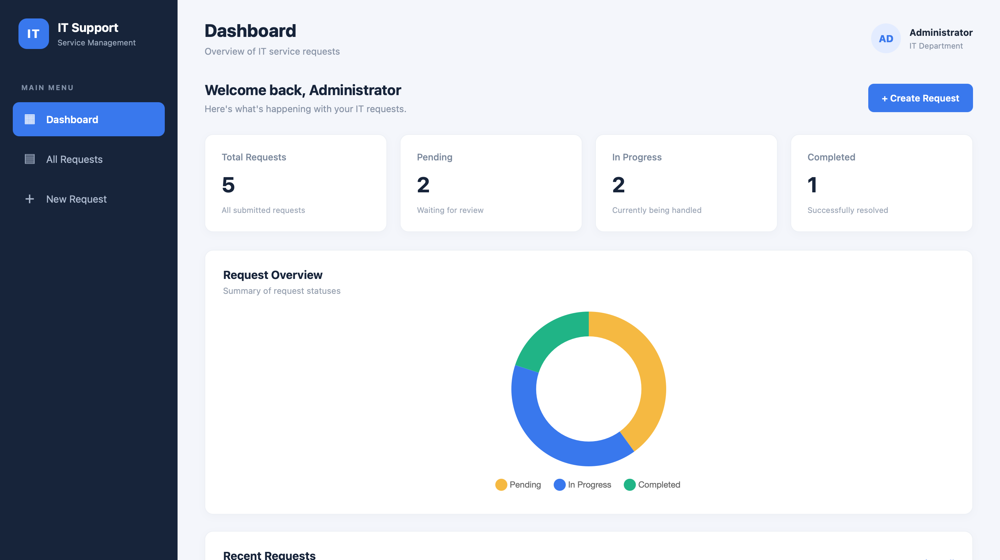
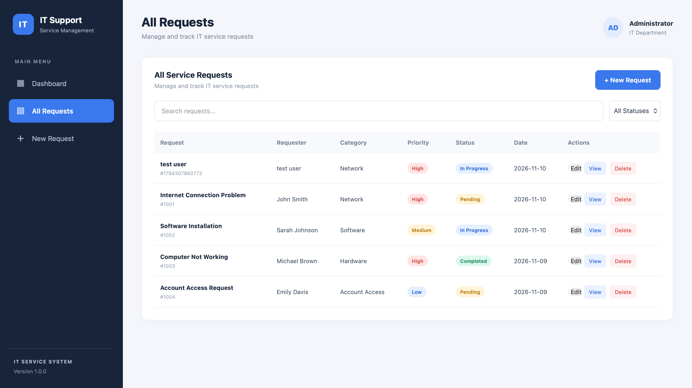
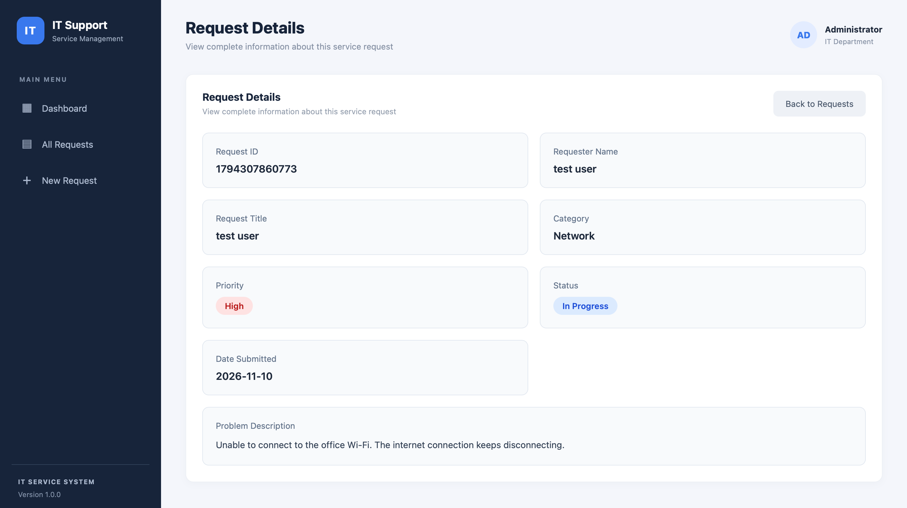

# IT Service Request System

## Project Overview

IT Service Request System is a simple web application designed to help manage and track IT service requests.

Users can submit new requests, view request details, update request information, and monitor request statuses through a dashboard.

## Website Preview

### Dashboard


### All Requests


### Request Details


## Features

- Dashboard displaying request statistics
- Create new IT service requests
- View all submitted requests
- Search and filter requests
- View complete request details
- Edit and delete requests
- Update request status
- Display request priority and status badges
- Save data using LocalStorage

## Technologies Used

- HTML5
- CSS3
- JavaScript
- Chart.js
- LocalStorage
- Visual Studio Code

## Project Structure

```text
it-service-request-system/
├── assets/
│   ├── dashboard.png
│   ├── all-requests.png
│   └── request-details.png
├── index.html
├── style.css
├── script.js
└── README.md
```

## How to Run

1. Download or clone this repository.
2. Open the project folder in Visual Studio Code.
3. Open `index.html` using the Live Server extension.
4. The application will open in your web browser.

## Project Purpose

This project was created to practice front-end web development, JavaScript programming, and basic data management.

## Note

This is a front-end prototype. Request data is stored locally in the browser using LocalStorage.
